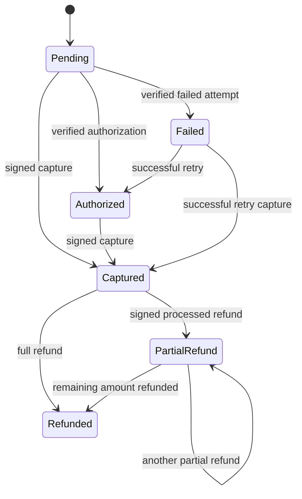

# KNOKH upgrade and release review

19 November 2026. Draft for review. Production authorization is required before merge, production configuration, production DNS changes, enabling live keys, or conducting a live transaction.

## Architecture and release findings

- Baseline GitHub main `0d90d82781e61ba2abc098b4236da83aa69ad561`. The repo contains a React 19/Vite SPA, React Router v7, Tailwind/Shadcn, Convex under `src/convex`, Convex Auth 0.0.98 and Auth.js Core 0.41.3. Authentication uses Convex Auth email OTP with Resend plus Anonymous. There was no GitHub Actions workflow on this baseline. The tracked lockfile is npm and the observed Pages build also uses npm. The README mentions Bun, which was unavailable in the executor.
- Cloudflare account read showed the existing GitHub-connected Pages project `knokh-preview` serves `knokh.com` and builds production from `main`, with automatic branch previews. The observed build command was `npm install && npm run build`. Cloudflare reported the baseline commit as the canonical production deployment. No backend deployment step or deploy key appeared in the Pages production settings. The app's hard-coded default Convex origin names `agreeable-caterpillar-156`. Earlier release notes identify `tame-lemur-590` as staging, and its public health endpoint responded. Convex deployment dashboard, active source revision, data segregation and environment settings could not be confirmed using authorized access here.
- Risk requiring release coordination: the previous Pages preview build inherited the production Convex URL when a URL was missing. New preview builds fail closed. The backend checkout/detail inputs also change. Previously loaded storefront tabs need a reload and checkout needs a coordinated cutover window. Existing schema fields and indexes are retained. Added order/payment fields are optional and new indexes are additive. Legacy guest order contact details remain in the database and are no longer retrievable using an order ID and email address. Existing guest customers can use limited tracking or support.
- Payment models already existed in `orders`, `order_items`, `payments`, `payment_events`, `refunds`, cart and supplier-fulfilment tables. The old entry points exposed guest orders by order ID and treated a Razorpay browser signature as capture. Webhook persistence included raw input, had weak event deduplication and matched Razorpay refunds against the wrong identifier. Admin status controls could also bypass capture. The patch addresses these paths. PayPal and Cashfree historical records and their legacy inbound paths remain, while fresh sessions and refund submissions only use Razorpay. The fake gateway cannot create or settle orders through the upgraded app.
- Webhook capture or refund evidence can race the initial database write. Razorpay order creation is locked transactionally before the POST and a lost response holds the lock for support reconciliation. A no-match signed webhook returns 503 so the provider can retry. Contact/payment data from invalid requests is not stored. New trusted reconciliation anomalies are recorded against the order without the body. Historical raw event rows and past “paid” records require a protected retention and provider reconciliation review.
- Zone read found an active Free Website plan and no custom WAF, managed WAF or rate-limit entrypoint returned for the three inspected phases. This reads configured rulesets only. Cloudflare edge coverage does not extend to the direct Convex API and webhook domains. Cloudflare DNS had MX records, which establish domain mail routing only. Delivery to both named inboxes and Resend domain verification are unverified.
- Remaining high-risk paths include guest order adoption after authentication, unauthenticated abuse across multiple guest sessions, legacy pending payment recovery, ambiguous provider POSTs, storefront CSP enforcement, order-attempt expiry with safe stock release, operational monitoring and staff access assignments. No existing member role receives new privilege. Complete the organization-wide endpoint and access review before release. Code inspection focused on auth, checkout, payment, orders, sync and file import entry points. Standard import workflows already use file size limits and bounded HTTPS fetches. This was not a comprehensive independent penetration test.

## Configuration and secret inventory

Values belong in the target platform settings. Environment values, auth tokens, backup contents and gateway payloads must stay out of the repository and review discussion.

| Location | Names | Required verification |
| --- | --- | --- |
| Pages preview build | `VITE_CONVEX_URL`, `VITE_GOOGLE_SIGN_IN` | Set only an isolated Convex URL. Enable the Google switch only with matching stage keys. Use a stable branch alias for the redirect destination. |
| Pages production build | `VITE_CONVEX_URL`, `VITE_GOOGLE_SIGN_IN`, `SKIP_DEPENDENCY_INSTALL` | Preserve existing GitHub Pages project and main. Set the confirmed backend URL and stage OAuth before enabling the UI. Any CLI deployment key belongs to a scoped release workflow. |
| Convex Auth | `CONVEX_SITE_URL`, `SITE_URL`, `JWT_PRIVATE_KEY`, `JWKS`, `AUTH_GOOGLE_ID`, `AUTH_GOOGLE_SECRET` | Use deployment-specific OAuth clients. Configure the exact storefront origin and the deployment callback `/api/auth/callback/google` on the Convex HTTP origin. Preserve existing production JWT signing material. |
| Email OTP | `RESEND_API_KEY`, `RESEND_FROM_EMAIL` | Verify the transactional sender domain and staging OTP delivery. Confirm separate inbound working addresses for orders and general support. |
| Guest and delivery | `KNOKH_GUEST_CHECKOUT_SECRET`, `KNOKH_DELIVERY_CONFIG` | Generate a deployment-specific high-entropy signing key. Rotation expires outstanding guest links. Enter the real carrier serviceability and dispatch inputs. |
| Razorpay | `KNOKH_PAYMENT_MODE`, `KNOKH_SANDBOX_SITE_ORIGIN`, `RAZORPAY_KEY_ID`, `RAZORPAY_KEY_SECRET`, `RAZORPAY_WEBHOOK_SECRET` | Enable Razorpay in Admin settings after provider onboarding. Use different webhook signing secrets in separate merchant environments. Configure automatic capture in the merchant test dashboard and verify capture. Configure the exact webhook route `/payments/webhook/razorpay`. |
| Historical providers | `CASHFREE_CLIENT_ID`, `CASHFREE_CLIENT_SECRET`, `CASHFREE_ENV`, `PAYPAL_CLIENT_ID`, `PAYPAL_CLIENT_SECRET`, `PAYPAL_ENV`, `PAYPAL_WEBHOOK_ID` | Review historical outstanding payments before vendor offboarding. Cashfree checkout remains disabled pending an implementation and sandbox review. |
| Deployment access | `CONVEX_DEPLOYMENT`, `CONVEX_DEPLOY_KEY` | Dedicated test credentials and short-lived or narrowly scoped release access are required. Preview builds should have no backend deploy key. |

Per official Convex Auth guidance, register the callback on the deployment HTTP domain and the actual allowed JavaScript origins in Google Cloud. KNOKH's Google provider requires verified Gmail or managed Google Workspace addresses. Other Google accounts can continue with OTP. This constrains automated account linking to addresses for which Google is authoritative. Test matching a previously OTP-verified account including an administrator test account, a nonmatching account, existing anonymous sessions, session refresh/logout and failed/denied Google consent. Document a deliberate privileged-account access policy and key rotation procedure.

## Delivery configuration and limitations

`KNOKH_DELIVERY_CONFIG` is validated JSON with `originPin`, `carrier`, `dispatchDays`, `nonWorkingWeekdays` (0 is Sunday), `holidays` (ISO dates) and `destinations` (exact six-digit PIN mapped to `minDays` and `maxDays`). This release assumes a single approved serviceability and business-day calendar, with no order-time cutoff and no Express rate. Use confirmed origin/transit data and a calendar that covers supplier and carrier closures. Do not use unverified estimates for drop-shipped origins. A missing configuration, unsupported PIN or unavailable address prevents new checkout. Keep existing cart and order records. Only INR is charged. Confirm live GST, shipping rates, COD eligibility and product restrictions with the business.

## Payment lifecycle

- A checkout request ID is scoped to its cart owner and uses an indexed transaction that also reserves stock and consumes the cart. Guest payment and detail state requires a server-issued order-scoped token valid for 24 hours. It is kept out of URLs. A Razorpay session POST is guarded by a local reservation and known sessions are reused. Check the gateway receipt and stored amount before resolving an ambiguous create. Never clear a lock while an upstream order may exist.
- The browser callback verifies the stored Razorpay order ID and payment signature. It leaves order status unchanged. Amount and currency must match the signed capture event and the internal order/payment. A late failure or repeated capture cannot undo capture or a refund. Only a valid capture queues online fulfilment.
- A processed refund is associated by provider payment ID, provider refund ID, and the internal refund ID in the Razorpay receipt when available. The provider supports `X-Refund-Idempotency`; the refund record ID is the stable key. Pending reservations and completed refunds are checked before provider submission. Different signed event IDs for the same refund do not count it twice. Ambiguous provider responses and externally created concurrent refunds require payment operations to review residual discrepancies through the Razorpay dashboard. Automated recovery, failed-refund retry decisions and regular financial reconciliation are release gates.
- Verify signed raw UTF-8 bytes, including whitespace, before accepting payload fields. Record provider event ID, safe status, local identifiers and errors. Webhook configuration must subscribe to `payment.authorized`, `payment.captured`, `payment.failed` and `refund.processed`. Use the merchant dashboard to monitor refund failures and settlement discrepancies. Webhook verification should continue during an incident in which creation is disabled.
- Use the official hosted checkout and do not handle card data or UPI PINs. Obtain acquirer guidance on the actual PCI scope, including script safeguards when payment forms are embedded. Confirm the merchant's requirements for card-on-file, data retention, customer disputes, incident reporting and payments regulation with professional advisers.

Provider references

- [Convex Auth Google configuration](https://labs.convex.dev/auth/config/oauth/google)
- [Razorpay integration](https://razorpay.com/docs/payments/payment-gateway/web-integration/standard/integration-steps)
- [Razorpay webhook verification](https://razorpay.com/docs/webhooks/validate-test)
- [Razorpay normal refunds and idempotency](https://razorpay.com/docs/api/refunds/create-normal)
- [Cashfree webhook verification](https://www.cashfree.com/docs/payments/online/webhooks/signature-verification)
- [PCI SSC SAQ A scripts FAQ](https://www.pcisecuritystandards.org/faqs/1588/)
- [RBI card-on-file direction](https://www.rbi.org.in/scripts/NotificationUser.aspx?Id=12363&Mode=0)
- [Consumer Protection (E-Commerce) Rules, 2020](https://consumeraffairs.gov.in/public/upload/files/E%20commerce%20rules_1732703966.pdf)

## Draft policy for review

Change-of-mind returns and refunds are unavailable. Your rights under Indian consumer law still apply. Contact order support if an order arrives defective, damaged, counterfeit or materially different from its description, is undelivered or late in circumstances covered by law, or otherwise qualifies for a remedy. Include the order number and a brief description. KNOKH will review the issue and provide the remedy required by applicable law. Approved online refunds generally use the original payment method where supported.

Before publication, legal and business reviewers should confirm the registered entity, grievance officer, contact channels, processing timelines, marketplace and inventory roles, and statutory remedies. Retain the ability to resolve complaints, track refunds and handle provider disputes.

## Deployment and recovery

1. Keep the pull request in draft until the checklist is resolved. Verify GitHub repository administration, MFA, main protection, review and CI requirements, Pages and Convex least-privilege access, and rollback operators. The repo rulesets API returned an empty list and branch protection reads returned 403.
2. Confirm a dedicated Convex preview/dev target with only synthetic fixtures and appropriate keys. Configure a stable Pages preview origin, Google OAuth sandbox client, delivery configuration, working email and Razorpay test merchant. Stage Convex and build the Pages branch against it. Preview must never use the named production deployment.
3. Run local and preview verification. Use official Razorpay test UPI and cards and test captured, pending, failed, dismissed, retry, duplicate/delayed webhooks, partial/full refunds, dashboard reconciliation and cancellation. Test Google, existing OTP/guest, accessibility and mobile real-device navigation. Ensure isolated preview never auto-forwards supplier orders. Confirm sitemaps, robots, canonical metadata and rendered structured data. Measure Core Web Vitals and use CSP report-only findings to document the narrowest working policy before enforcement. Verify the platform applies the security headers to SPA deep-link responses. Page Functions own headers for the two SEO endpoints.
4. Obtain owner/legal approval for publication and explicit authorization for merge, production Convex changes, live keys and any production DNS/configuration mutation. Confirm the new build can roll forward or back in the planned maintenance window. Keep real payments disabled until both tiers match. Confirm a fresh restorable Convex backup and validate an isolated restore. Prior release notes report a two-backup limit and no fresh slot. Recheck the current plan and backup inventory. Preserve the older backups until the owner approves any necessary deletion or another supported approach.
5. Use approved Expand → verify → cutover ordering. Add optional schema and indexes with staged production validation, deploy the reviewed backend and release the matching frontend in the existing GitHub Pages workflow. Smoke-test catalog, checkout gates and OAuth without money. Keep a record of the actual source/deploy IDs and active checkout configuration. Any live payment is a separately approved low-value transaction with a documented refund and reconciliation plan.
6. Monitor Convex function failures and Razorpay webhook/capture/refund dashboards during release. For a discrepancy, disable starting sessions, preserve webhook receipt and provider evidence, and reconcile orders in all states before allowing fulfilment. For frontend failure select the previous known-good Pages deployment. For backend rollback use a reviewed compatibility build and keep optional schema fields and indexes while anyone still writes them. Convex data gaps require a separate restore decision, including reconciliation of records created since the backup. Never assume a rollback of code reverses money movement, stock, schema or records.

## Requirement readiness checklist

PASS denotes verified source or local behavior. BLOCKED denotes a missing integration, environment or remaining engineering work. NEEDS OWNER APPROVAL denotes an operational or policy gate. None of these statuses denotes a production release.

| # | Status | Evidence or remaining gate |
| --- | --- | --- |
| 1 | BLOCKED | Official Google provider and OAuth start/verifier test. Google client setup and provider callback need an isolated environment. |
| 2 | BLOCKED | Email OTP/session and redirect regressions pass. Verify Google-to-OTP linking, anonymous conversion and logout browser flows in preview. |
| 3 | BLOCKED | Layered controls added to sensitive paths. Full endpoint and infrastructure hardening remain. |
| 4 | BLOCKED | Scoped access and payload redaction added. Historical data retention and storage encryption review remain. |
| 5 | BLOCKED | Checkout/capture/refund invariants pass local tests. Provider E2E remains. |
| 6 | PASS | Backend privilege and ownership guards enforce checkout/order/payment boundaries in tests. Whole-app review remains under 48–49. |
| 7 | BLOCKED | Metadata and Pages SEO routes implemented. Preview indexing verification remains. |
| 8 | BLOCKED | Product, breadcrumb, canonical and social metadata implemented. Validate representative rendered variants and share previews. |
| 9 | BLOCKED | Dedicated Pages routes and private route headers. Live responses still return HTML. Sitemap uses a 2,000-product query bound, so validate catalog size and paginate when needed. |
| 10 | BLOCKED | Existing route splitting retained, with asset cache and image loading improvements. Field metrics and real-device QA remain. |
| 11 | PASS | Checkout rejects a non-Indian shipping address in a backend integration test. |
| 12 | BLOCKED | Validated India SLA configuration and date arithmetic tests pass. Requires real origin/serviceability and carrier calendar data. |
| 13 | BLOCKED | Product, checkout and order range rendering added. Manual browser verification remains. |
| 14 | BLOCKED | Order support address appears in the site. Confirm delivery to the mailbox. |
| 15 | BLOCKED | General enquiries address appears in the site. Confirm delivery to the mailbox. |
| 16 | BLOCKED | Mailto links added and transactional sender preserved. Confirm inbound addresses and verified Resend sender. |
| 17 | BLOCKED | Razorpay Orders API, INR integer amount and authoritative pricing tested locally. Verify with approved sandbox merchant. |
| 18 | BLOCKED | Legacy Cashfree data and adapter evidence retained. New Cashfree checkout disabled. Requires current integration review and sandbox tests before any activation. |
| 19 | PASS | Signature-only browser callback stays pending. Signed matching capture is required in the local integration test. |
| 20 | PASS | Refund reconciliation matches the provider payment and provider refund references. Internal receipt links reserved records when available. |
| 21 | BLOCKED | Integer and cumulative limits tested. Confirm provider refunds and settlement reconciliation in sandbox. |
| 22 | BLOCKED | Checkout, signed replay and fulfilment guards tested. Sandbox retries and operational recovery for ambiguous create/capture/refund calls remain. |
| 23 | PASS | Stale failure and capture after a refund cannot undo settled states in tests. |
| 24 | BLOCKED | Expiring order-scoped tokens and guest isolation tested. Cart credentials remain browser-generated and past guest order adoption is unavailable. |
| 25 | BLOCKED | Safe key-mode checks and webhook source wiring added. Merchant configuration and real signed event delivery unverified. |
| 26 | BLOCKED | Provider-approved UPI/card and refund sandbox scenarios require merchant sandbox access. |
| 27 | PASS | Fake checkout route and simulation action removed. Razorpay live mode requires live-prefixed keys. Sandbox refuses known production origin. |
| 28 | NEEDS OWNER APPROVAL | Change-of-mind restriction drafted. Approve final wording and business process. |
| 29 | NEEDS OWNER APPROVAL | Product and checkout notices added in source. Approve before publication. |
| 30 | NEEDS OWNER APPROVAL | Policy page and links added in source. Approve before publication. |
| 31 | NEEDS OWNER APPROVAL | Draft retains legal remedies. Verify grievance handling, required disclosures and refund process with counsel. |
| 32 | BLOCKED | Capture, ownership, refund and replay controls added. Provider, security and operational verification remain. |
| 33 | BLOCKED | Consulted official provider guidance and corrected legacy Cashfree signature calculation. Cashfree activation remains gated. |
| 34 | PASS | Inspected Razorpay flow uses official hosted collection and stores no PAN, CVV or UPI PIN. |
| 35 | BLOCKED | Strict UTF-8 and signed replay regressions pass for Razorpay. Verify real event ordering and legacy providers. |
| 36 | BLOCKED | Hardened Razorpay server fetch and redirect policy. Verify Cloudflare TLS/HSTS and legacy paths in preview. |
| 37 | BLOCKED | Backend guards and idempotent refunds added. Merchant fraud controls and multi-origin abuse remain. |
| 38 | BLOCKED | Secret names and build boundary audited. Confirm actual environment handling and deployed client bundle before activation. |
| 39 | BLOCKED | Checkout capped per owner. IP/device and bot controls, and reliable cross-session abuse limits, remain. |
| 40 | BLOCKED | Redacted payment events and reconciliation notes written. Alert delivery and settlement reconciliation remain. |
| 41 | NEEDS OWNER APPROVAL | Scope and official references documented. Confirm PCI scope and Indian regulatory obligations with advisers and the provider. |
| 42 | BLOCKED | Local security regression passed. Provider sandbox activation tests outstanding. |
| 43 | BLOCKED | Focused review completed. Full OWASP ASVS verification remains. |
| 44 | BLOCKED | Redirect, HTTP, ownership and supplier data corrections. Full application threat review remains. |
| 45 | NEEDS OWNER APPROVAL | Reviewed Free plan and ruleset state. Configure/test approved WAF and verify DDoS coverage for the storefront and direct backend. |
| 46 | BLOCKED | Convex Auth session settings preserved and OAuth library used. Validate token lifetime, state, PKCE, refresh/logout and cookie behavior in preview. |
| 47 | BLOCKED | Existing backend customer/admin permissions enforced. Separate staff entitlement and operations UI need an approved access matrix. |
| 48 | BLOCKED | Audited high-risk checkout, authentication, payment, orders, catalog and supplier entry points. Complete a signature-level inventory and test every exposed function. |
| 49 | BLOCKED | New guest and order/payment ownership tests pass. Complete end-to-end access regression for profiles, addresses, carts and legacy guest records. |
| 50 | BLOCKED | HSTS, frame, MIME and referrer headers added. CSP is report-only pending provider/mobile browser validation and documented exceptions. |
| 51 | BLOCKED | Existing OTP verification throttling and new checkout owner cap. Bot mitigation and OTP delivery abuse limits remain. |
| 52 | BLOCKED | Existing import size and bounded fetch checks identified. Full file-content, object access and untrusted-input review remains. |
| 53 | BLOCKED | Tightened ignore rules and dependency/patch checks. Historical tracked environment filenames contained only public variable names in this review. Run a dedicated full-history secret scan and rotate only confirmed exposures with authorization. |
| 54 | BLOCKED | Reduced client error detail and redacted payment event writes. Monitoring, alert routing and diagnostics drill remain. |
| 55 | BLOCKED | Workflow source and local checks exist. Confirm GitHub accepted the workflow and its checks run on the draft PR. |
| 56 | BLOCKED | Backup/restore/rollback procedure documented. Verify current backup quota and an isolated restore. |
| 57 | BLOCKED | Local regression tests cover major checkout and capture/refund paths. Manual security and browser QA and independent professional penetration testing remain appropriate before live payments. |
| 58 | NEEDS OWNER APPROVAL | Checked branch/project configuration. Review admin access, branch protection, deployment credentials and release roles with owner and apply approved changes. |

## Test report and SEO evidence

| Check | Result | Evidence |
| --- | --- | --- |
| Dependency install | PASS | Clean `npm ci` with the existing package-lock and Node 24. |
| TypeScript and build | PASS | Offline generated Convex API/schema types, `tsc -b`, and production Vite output. The build reports upstream Rollup annotation and empty-chunk warnings. |
| Unit and integration | PASS | 86 tests in 6 suites via Vitest. Covers OTP compatibility and Google OAuth startup, Indian delivery calendar, checkout ownership and concurrent retries, signed webhook parsing/replay, stale state, refund totals and admin capture override. |
| Lint | PASS | Repository-wide ESLint ran with zero errors and 13 warnings. No lint or security rules were disabled. |
| Dependency audit | PASS | npm reported zero known findings after upgrading the affected development dependency chain. |
| Preview isolation | PASS | Simulated Pages preview builds were rejected with no backend URL and with the known production URL. Cloudflare branch preview needs an authorized isolated Convex deployment. |
| SEO endpoints | PASS locally | Direct Pages handler checks covered storefront robots, preview no indexing and XML proxying with a fixture upstream. Live baseline HTTPS requests returned HTML for both routes before this change. Search Console and Cloudflare serving checks are pending. |
| Homepage contrast | PASS | Existing script passed its five checks, including a 4.53:1 minimum muted foreground contrast. |
| Browser and mobile | BLOCKED | Local Chromium could not start due to host socket restrictions. Device, keyboard, real-world mobile and browser CSP tests remain. |
| Provider-approved sandbox | BLOCKED | No Razorpay live or test transaction, actual provider OAuth consent/callback or gateway refund was attempted. Signed event tests use local fixtures. |
| Convex deployment | BLOCKED | Local Convex CLI attempt terminated before a deployment was created. Cloud staging credentials and data separation are still needed. |
