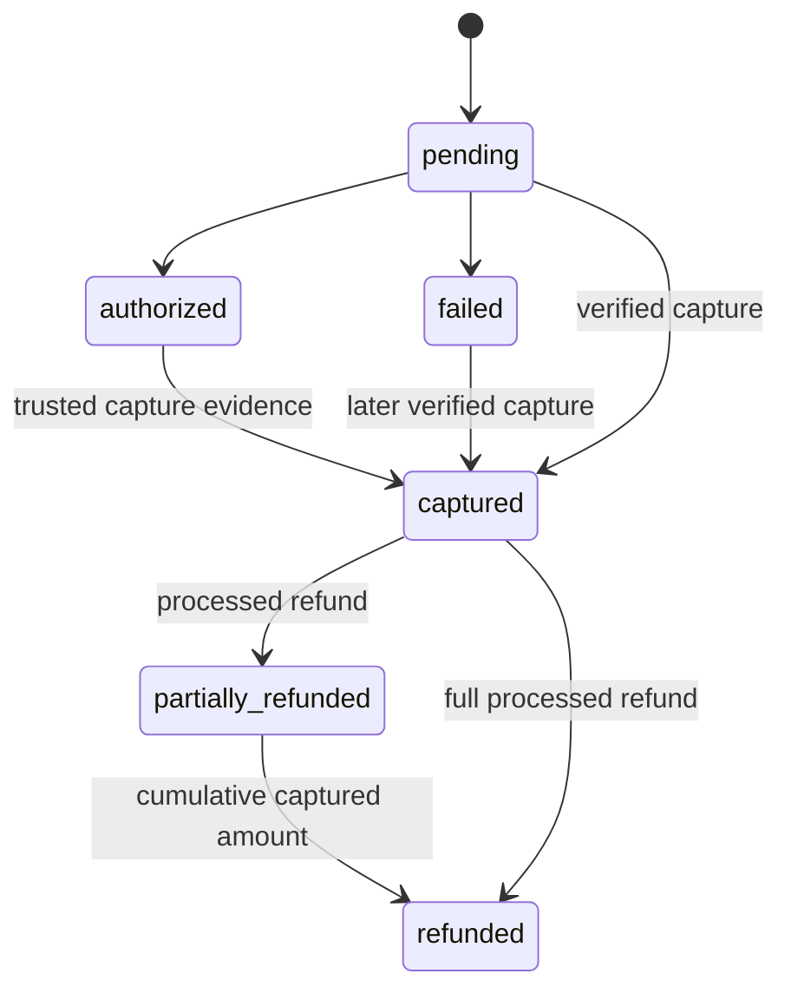

# KNOKH master upgrade status

Audit date: 27 November 2026 (India). Each row maps to the numbered section in the owner request. This is a partial implementation record, not a completion certificate.

| Section | Requirement | Classification | Evidence or blocker |
|---|---|---|---|
| 1 | Project and preservation | ALREADY PRESENT AND VERIFIED | React 19/Vite/Convex; Pages GitHub production branch main; production commit 02f783cba5ccf1fa629e5d9135fc54578fd6fe0d. No production writes in this upgrade. |
| 2 | Mission | IMPLEMENTED — TESTING PENDING | Reconciled earlier security draft with PR17; implementation is incomplete and must not merge. |
| 3 | Autonomous access | REQUIRES MANDATORY OWNER ACTION | GitHub, Cloudflare and Resend read access works. Convex CLI reports MissingAccessToken. Razorpay connector is read-only. |
| 4 | Provider key automation | BLOCKED BY PROVIDER | No credential regeneration: current key validity is unverified; authenticated Convex write access unavailable. |
| 5 | Secret generation | AUTOMATICALLY CONFIGURED AND VERIFIED | Cloudflare issued a separate preview Turnstile credential. No application signing secrets rotated. |
| 6 | Environment configuration | IMPLEMENTED — TESTING PENDING | Preview VITE_CONVEX_URL points at flippant-poodle-732. Turnstile public key and server secret saved only in Pages preview; Convex transfer pending. |
| 7 | Credential matrix | BLOCKED BY PROVIDER | See integration inventory below; no missing provider credential was fabricated. |
| 8 | Secret management | IMPLEMENTED — TESTING PENDING | Ignore environment files, diff secret scanner, redacted Gitleaks history scan; credential lifecycle and compromise rotation require validation. |
| 9 | Data preservation | ALREADY PRESENT AND VERIFIED | Only source and isolated preview settings changed. No production data export, reset or imports performed. |
| 10 | Repository audit | IMPLEMENTED — TESTING PENDING | Reviewed README, package/lock, schema, auth, main, checkout/payments/refunds, guest orders, SEO, Pages settings, tests and workflows. Full exposed-function audit remains incomplete. |
| 11 | Authentication | IMPLEMENTED — TESTING PENDING | Google config/logo preserved; OTP regression tests use synthetic mail provider. Actual Google/Resend delivery not retested; request cooldown and bot controls pending. |
| 12 | Turnstile | IMPLEMENTED — TESTING PENDING | Managed widget KNOKH isolated preview created for knokh-preview.pages.dev. No forms claim enforcement; backend Siteverify/action/hostname checks and atomic token receipt consumption remain to implement. |
| 13 | Website security | IMPLEMENTED — TESTING PENDING | Ownership/payment fixes reconciled; response headers and report-only CSP added. CSP is not enforced and requires browser/provider validation. No absolute-security claim. |
| 14 | Cloudflare security | IMPLEMENTED — TESTING PENDING | Pages deployment/source/env isolation audited. Zone TLS/WAF/bot/rate rules and DNSSEC not changed or verified. |
| 15 | Backend security | IMPLEMENTED — TESTING PENDING | Scoped guest-order capabilities, backend admin ownership and payment state checks; exhaustive API exposure audit pending. |
| 16 | Privacy | IMPLEMENTED — TESTING PENDING | Removed guest-email URL authority; redacted order/payment responses. Retention, complete deletion, marketing unsubscribe and Indian privacy/legal review pending. |
| 17 | Razorpay | IMPLEMENTED — TESTING PENDING | Hosted checkout, server totals, INR/key mode gate and capture verification; no real sandbox provider transaction executed. |
| 18 | Webhooks | IMPLEMENTED — TESTING PENDING | Raw HMAC before writes; invalid signatures cannot poison event IDs; duplicate/stale state protections and body bounds. Actual provider delivery pending. |
| 19 | Refunds | IMPLEMENTED — TESTING PENDING | Provider payment/refund matching, integer cumulative limits, partial/full/replay tests; no financial operation executed. |
| 20 | Cashfree | IMPLEMENTED — TESTING PENDING | Legacy records readable; initiation disabled until approved configured sandbox passes. Not a complete new integration. |
| 21 | Guest checkout | IMPLEMENTED — TESTING PENDING | HMAC scoped expiring order tokens and safe redirects; legacy guest orders may need support-assisted recovery after expiry. Cart identities still client-generated high-entropy bearer keys. |
| 22 | COD | IMPLEMENTED — TESTING PENDING | Manual fulfilment and admin COD configuration exist; no integrated COD collection, remittance or RTO automation. |
| 23 | India restriction | IMPLEMENTED — TESTING PENDING | Backend country/currency/PIN format restriction plus regression coverage. State/PIN lookup data pending. |
| 24 | Official PIN dataset | BLOCKED BY PROVIDER | data.gov.in resource currently returned sandbox/incomplete metadata. No authoritative full dataset ingested. Six-digit format is not proof a PIN exists; all Karnataka coverage is not claimed. |
| 25 | Delivery estimates | REQUIRES MANDATORY OWNER ACTION | Origin, dispatch, holidays and per-PIN transit configuration supported. No courier/business-origin schedule exists; checkout fails closed without verified configuration. Do not enable with invented carrier data. |
| 26 | Couriers | REQUIRES MANDATORY OWNER ACTION | No confirmed provider/account. Full Shiprocket/Delhivery/India Post/DTDC/Blue Dart adapter implementations pending. No shipment or fee incurred. |
| 27 | Fraud | IMPLEMENTED — TESTING PENDING | Duplicate checkout/payment gates; full velocity/COD review queue pending. FraudLabs disabled; no customer data shared. |
| 28 | SEO | IMPLEMENTED — TESTING PENDING | Preserved deployed canonical/product/breadcrumb metadata and favicon. React rendering, real HTTP404 and current field performance not independently verified. |
| 29 | Structured data | IMPLEMENTED — TESTING PENDING | Product/Offer/Breadcrumb existing; accurate MerchantReturnPolicy/OfferShippingDetails must wait for reviewed business configuration. |
| 30 | Sitemap/robots | ALREADY PRESENT AND VERIFIED | Deployed snapshot fallback retained; prior live verification exists. Live endpoints not reverified this session; dynamic freshness remains limited by builds when edge origin fetch fails. |
| 31 | Search Console | REQUIRES MANDATORY OWNER ACTION | Google project authorization/API identity and domain access not available through current connectors. No sitemap submission or indexing success claimed. |
| 32 | Performance | IMPLEMENTED — TESTING PENDING | Existing code splitting/images retained. No measured before/after Lighthouse/Core Web Vitals results. |
| 33 | Email | ALREADY PRESENT AND VERIFIED | Resend reports knokh.com verified with sending enabled and tracking disabled. Receiving disabled in Resend; Zoho mailbox delivery not tested. Transactional notification suite not fully implemented. |
| 34 | Returns policy | IMPLEMENTED — TESTING PENDING | Draft restricts discretionary returns with mandatory-remedy exceptions; qualified legal/grievance details review needed. |
| 35 | Security scanners | IMPLEMENTED — TESTING PENDING | Added scheduled redacted Gitleaks and OSV pinned versions plus existing Dependabot and npm audit. Actual outcomes below; scanner findings remain release blockers; CodeQL eligibility/config pending. |
| 36 | Public APIs | IMPLEMENTED — TESTING PENDING | Prioritized essential official integrations. No directory listing treated as provider endorsement or credential source. |
| 37 | Dropshipping | IMPLEMENTED — TESTING PENDING | Existing supplier/catalog/CSV/SKU/queue infrastructure preserved. No approved DeoDap order API/terms/account or real forwarding. |
| 38 | Admin dashboard | IMPLEMENTED — TESTING PENDING | Existing protected order/product/supplier controls preserved; full status/monitoring reports pending. |
| 39 | Inventory | IMPLEMENTED — TESTING PENDING | Transactional stock/order code and regression suite retained; wider concurrent race/provider stress testing pending. |
| 40 | Monitoring and costs | IMPLEMENTED — TESTING PENDING | No paid plans purchased; no new recurring subscription commitment. Incident alert routing, usage thresholds and zero-cost quotas not fully verified. |
| 41 | Automated tests | IMPLEMENTED — TESTING PENDING | 110 tests pass locally, typecheck/build pass, lint 0 errors/13 warnings, npm audit zero. Tests use synthetic data and mocked provider responses; not sandbox E2E. |
| 42 | CI/CD | IMPLEMENTED — TESTING PENDING | PR17 extended, pinned actions and least privilege. CI outcomes must be read after publication; production branch untouched. |
| 43 | Preview | IMPLEMENTED — TESTING PENDING | Pages preview points at existing separate Convex. Backend code update blocked by expired CLI authorization; no end-to-end preview claim. |
| 44 | Backup/rollback | REQUIRES MANDATORY OWNER ACTION | Record Pages production deployment 43fca917-52ba-43b6-9a69-0595ba633f8b. Convex backup/export availability and restore need authenticated access; never restore over newer orders. |
| 45 | Production release | REQUIRES MANDATORY OWNER ACTION | Blocked until backend push, integration tests, shipping configuration, security gaps and final explicit release approval. No production merge/deploy performed. |
| 46 | Owner intervention | REQUIRES MANDATORY OWNER ACTION | Consolidated blockers: authenticated Convex session; provider test credentials/account access; real shipping origin/dispatch policy; legal identity/policy review; final release approval. |
| 47 | Integration verification | IMPLEMENTED — TESTING PENDING | Only actual account evidence called verified. Credential presence is not integration success; capture/refund/email/Google E2E pending. |
| 48 | Deliverables | IMPLEMENTED — TESTING PENDING | This status, release runbook, diff and PR are provided. Complete final production report withheld until verified release. |
| 49 | Success criteria | IMPLEMENTED — TESTING PENDING | Not met; do not describe the platform as production-ready. |

## Integration inventory (names only)

Convex: AUTH_GOOGLE_ID, AUTH_GOOGLE_SECRET, SITE_URL, JWT_PRIVATE_KEY, JWKS, RESEND_API_KEY, RESEND_FROM_EMAIL, KNOKH_GUEST_CHECKOUT_SECRET, KNOKH_DELIVERY_CONFIG, KNOKH_PAYMENT_MODE, KNOKH_SANDBOX_SITE_ORIGIN, RAZORPAY_KEY_ID, RAZORPAY_KEY_SECRET, RAZORPAY_WEBHOOK_SECRET. Current credential values/validity not read.

Pages preview: VITE_CONVEX_URL (isolated), VITE_GOOGLE_SIGN_IN, VITE_TURNSTILE_SITE_KEY, TURNSTILE_SECRET_KEY. Turnstile server secret is held in Pages preview pending secure transfer to Convex; frontend code never reads it. No production widget/secret created.

GitHub: existing manual convex-production environment expects CONVEX_DEPLOY_KEY; presence/validity not verified.

## Payment state and event handling

Signature verification precedes event bookkeeping. Invalid signatures do not insert deduplication entries. Captured/refunded payments cannot be downgraded by stale authorization/failure. Repeated capture cannot restore refunded state or queue duplicate fulfilment. Refund IDs and payment IDs are reconciled with integer amounts and cumulative limits. Late capture after cancellation queues reconciliation rather than reopening fulfilment.

## Release and rollback

Before release: fix remaining controls, restore authorized Convex access, push and smoke-test ONLY flippant-poodle-732, verify real Razorpay test-mode outcomes/webhooks, validate shipping configuration and legal policy, inspect CI, obtain specific production approval, and verify a current backup/export and restore plan. Push compatible additive backend/schema changes before frontend that depends on them. Existing schema validation is disabled; enabling it requires a production-record audit and cannot be assumed safe.

Frontend rollback: use Pages rollback to the recorded prior production deployment. Backend rollback requires redeploying a reviewed compatible prior commit; new indexes/optional fields may remain. Data migrations are not automatically reversible. Never replace current orders/payments with an older database snapshot. Rotate only compromised credentials using a tested overlap procedure.

## Residual risks

Turnstile not enforced, full rate limiting and exposed-function review incomplete, schema validation disabled, manual courier/provider configuration missing, official PIN data not imported, CSP report-only with inline style allowance for existing UI, no real provider sandbox/browser/a11y/load/restore test evidence. Recommend an independent penetration test before live payment activation.

## Actual security scan findings (release blockers)

- npm audit: 0 reported vulnerabilities in the reconciled lockfile.
- Gitleaks v8.30.0: 1 generic-api-key finding in historical docs/CART_REPAIR.md, commit 7547736751c1c16ec06f22bcd913f431cd4aa201. Appears related to documented testing, but not fully triaged; no secret value reproduced or blanket exclusion added.
- OSV Scanner v2.3.0: 2 HIGH reports against xlsx 0.20.3: GHSA-4r6h-8v6p-xvw6 and GHSA-5pgg-2g8v-p4x9. The installed tarball is supplied by SheetJS outside npm. OSV ranges contain no fixed event; applicability to the vendor build requires primary-vendor evidence before an exception. These findings remain blocking; no scanner check disabled.
- Both scanner binaries were fetched from official GitHub releases and SHA256 verified against release asset digests. The scans were actually run, with secret findings redacted.
- Contrast script: PASS for all checked homepage token combinations. This is not a full accessibility audit.
